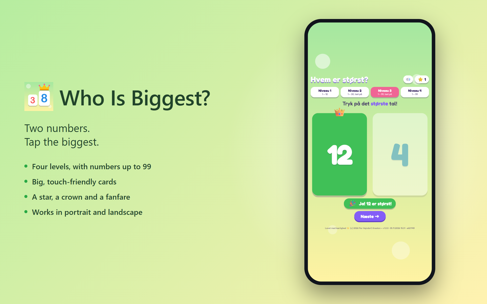

# Who Is Biggest?




**A tiny number game for young kids.**

Two numbers appear on big cards and the child taps the **biggest** one. A right answer earns a star, a crown and a fanfare; a wrong answer gets a friendly "Ups! Prøv igen!" (oops, try again) and a sad-trombone sound, and the wrong card is greyed out so they can try the other one.

It is a Blazor WebAssembly app (.NET 10) that runs entirely in the browser, with no server or backend. It can be pinned to the home screen on phones and tablets and then runs full screen like an app.

## Levels

| Level | Numbers | Gap between the two numbers |
|-------|---------|-----------------------------|
| 1     | 1 – 12  | any                         |
| 2     | 1 – 30  | at most 10 apart            |
| 3     | 1 – 99  | at most 10 apart            |
| 4     | 1 – 99  | any                         |

The two numbers are never equal, and a round never repeats the previous pair. Levels are defined in [`Game/NumberGame.cs`](src/WhoIsBiggest/Game/NumberGame.cs).

## Features

- Big, touch-friendly cards that work in portrait and landscape
- Star counter for correct answers
- Sounds synthesized with the Web Audio API in [`wwwroot/js/sounds.js`](src/WhoIsBiggest/wwwroot/js/sounds.js), so there are no audio files; a 🔊/🔇 button turns them off
- Web app manifest and Apple touch icons for "Add to Home Screen"

## Project layout

```
WhoIsBiggest.slnx
src/WhoIsBiggest/
  Game/NumberGame.cs        Levels and round logic (picks the two numbers)
  Pages/Home.razor          The game screen
  Layout/MainLayout.razor
  wwwroot/
    index.html              Host page, home-screen meta tags, <base href>
    css/app.css             All styling and animations
    js/sounds.js            Fanfare and try-again sounds
    manifest.webmanifest
    icons/                  App icons and favicon
```

## Running locally

Requires the [.NET 10 SDK](https://dotnet.microsoft.com/download).

```bash
dotnet run --project src/WhoIsBiggest
```

Then open http://localhost:5148 (or https://localhost:7290 with the `https` launch profile). You can also open `WhoIsBiggest.slnx` in Visual Studio and press F5.

## Publishing

Publish with:

```bash
dotnet publish src/WhoIsBiggest -c Release -o src/WhoIsBiggest/bin/Publish
```

Copy the contents of `bin/Publish/wwwroot` to any static web host.

The app is set up to be served from a `whoisbiggest` sub-path: `<base href>` in [`wwwroot/index.html`](src/WhoIsBiggest/wwwroot/index.html) is `whoisbiggest`. Change it if you host the app somewhere else, for example `/` for the site root.
